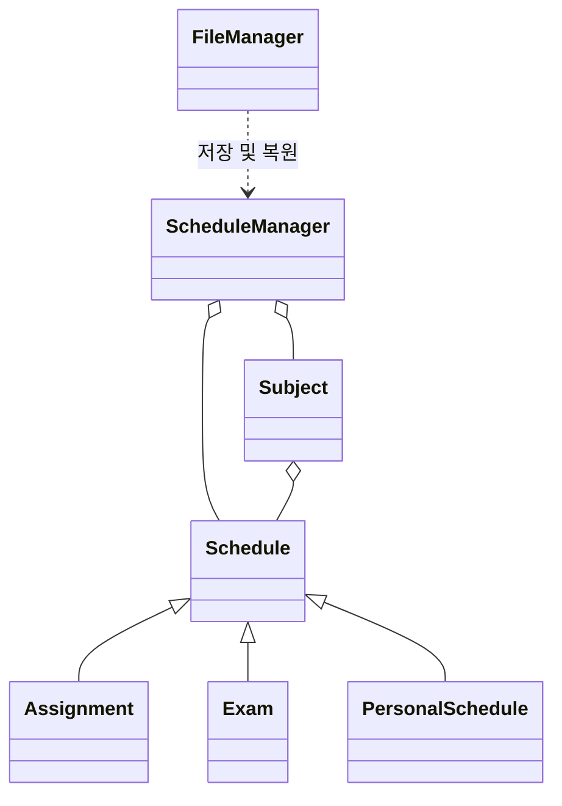

# UniPlan

대학생 통합 일정 관리 프로그램

대학SW·AI입문(SW) 2분반 팀 프로젝트

## 1. 프로젝트 소개

UniPlan은 대학생의 과제, 시험, 개인 일정을 한곳에서 관리할 수 있는 Python 기반 콘솔(CLI) 프로그램입니다.

대학생들이 여러 과목의 과제와 시험, 개인 일정을 효율적으로 관리할 수 있도록 일정 등록, D-day 계산, 완료 여부 확인 등의 기능을 제공합니다.

객체지향 프로그래밍의 클래스, 상속, 다형성, 메서드 오버라이딩을 활용하였으며, 각 클래스를 별도의 모듈로 구성하였습니다.

## 2. 주요 기능

- 과제, 시험, 개인 일정 등록
- 전체 일정 조회
- 일정 제목 및 날짜 수정
- 일정 삭제 및 완료 처리
- 제목 및 과목명으로 일정 검색
- 마감일순 정렬
- 일정 유형별 조회
- 과목 등록 및 과목별 일정 조회
- D-day 자동 계산
- 일정 유형별 개수 및 전체 완료율 계산
- JSON 파일을 활용한 데이터 저장 및 불러오기
- 입력값 검증 및 예외 처리

## 3. 개발 환경

| 구분 | 사용 기술 |
| --- | --- |
| 개발 언어 | Python 3.8 이상 |
| 개발 도구 | Visual Studio Code |
| 사용자 인터페이스 | CLI (Command Line Interface) |
| 데이터 저장 | JSON |
| 버전 관리 | Git, GitHub |

Python 표준 라이브러리만 사용하므로 별도의 패키지 설치가 필요하지 않습니다.

## 4. 실행 방법

### Repository Clone

```bash
git clone https://github.com/luzknar/SWAI-Team-Project.git
cd SWAI-Team-Project
```

### 프로그램 실행

```bash
python main.py
```

## 5. 프로그램 실행 화면

```text
========== UniPlan ==========
1. 일정 등록     2. 전체 일정 조회
3. 일정 수정     4. 일정 삭제
5. 완료 처리     6. 일정 검색
7. 유형별 조회   8. 과목 관리
9. 일정 통계     0. 저장 및 종료
메뉴 선택:
```

사용자는 메뉴 번호를 입력하여 원하는 기능을 실행할 수 있습니다.

## 6. 클래스 설계

프로그램은 총 7개의 클래스로 구성되어 있습니다.

| 클래스 | 역할 |
| --- | --- |
| Schedule | 일정의 공통 속성 및 기능 관리 |
| Assignment | 과제 정보 관리 |
| Exam | 시험 정보 관리 |
| PersonalSchedule | 개인 일정 정보 관리 |
| Subject | 과목 및 과목별 일정 관리 |
| ScheduleManager | 전체 일정 등록, 수정, 삭제, 검색 및 통계 관리 |
| FileManager | JSON 데이터 저장 및 불러오기 |

### 클래스 관계도



### 객체지향 프로그래밍 적용

- 상속(Inheritance)
  - Assignment, Exam, PersonalSchedule 클래스는 Schedule 클래스를 상속합니다.
  - 일정의 공통 속성과 메서드를 부모 클래스에서 관리합니다.

- 다형성(Polymorphism)
  - 동일한 메서드를 호출하더라도 일정 유형에 따라 서로 다른 정보를 출력합니다.

- 메서드 오버라이딩(Overriding)
  - 각 자식 클래스에서 get_info() 메서드를 재정의하여 일정 유형별 상세 정보를 출력합니다.

- 집합 관계(Aggregation)
  - ScheduleManager는 여러 일정과 과목 객체를 관리합니다.
  - Subject는 해당 과목에 속하는 일정 객체를 관리합니다.

- 모듈화(Modularization)
  - 각 클래스를 별도의 Python 파일로 작성합니다.
  - main.py에서 필요한 모듈을 import하여 프로그램을 실행합니다.

## 7. 일정 유형별 관리 정보

| 일정 유형 | 공통 정보 | 추가 정보 |
| --- | --- | --- |
| 과제 | 제목, 과목, 날짜, 완료 여부 | 제출 형식, 우선순위 |
| 시험 | 제목, 과목, 날짜, 완료 여부 | 시험 범위, 시험 유형 |
| 개인 일정 | 제목, 날짜, 완료 여부 | 일정 장소, 일정 유형 |

과제와 시험을 등록하면 해당 과목이 자동으로 등록되며, 개인 일정은 과목 없이 관리됩니다.

## 8. 입력값 검증 및 예외 처리

잘못된 입력으로 인해 프로그램이 종료되거나 처음부터 다시 입력해야 하는 상황을 방지하기 위해 입력값 검증 기능을 구현하였습니다.

필수 항목은 올바른 값이 입력될 때까지 재입력을 요청하며, 선택 항목은 빈칸으로 입력할 경우 기본값을 적용합니다.

| 입력 항목 | 빈칸 입력 시 처리 |
| --- | --- |
| 일정 제목 | 재입력 요청 |
| 과목명 | 재입력 요청 |
| 날짜 | 재입력 요청 |
| 제출 형식 | 미정 |
| 우선순위 | 중 |
| 시험 범위 | 미정 |
| 시험 유형 | 미정 |
| 개인 일정 장소 | 미정 |
| 개인 일정 유형 | 기타 |
| 일정 수정 | 기존 값 유지 |
| 일정 번호 | 재입력 요청 |
| 검색어 | 재입력 요청 |
| 메뉴 번호 | 재입력 요청 |

추가 예외 처리 사항은 다음과 같습니다.

- 공백만 입력한 경우 빈칸으로 처리
- 잘못된 메뉴 번호 입력 방지
- 존재하지 않는 일정 번호 입력 방지
- 잘못된 날짜 형식 입력 방지
- 실제 존재하지 않는 날짜 입력 방지
- 잘못된 우선순위 입력 방지

## 9. 프로젝트 구조

```text
SWAI-Team-Project/
├── main.py
├── schedule.py
├── assignment.py
├── exam.py
├── personal_schedule.py
├── subject.py
├── schedule_manager.py
├── file_manager.py
├── data/
│   └── schedules.json
├── tests/
│   └── test_uniplan.py
├── .gitignore
├── LICENSE
└── README.md
```

| 파일명 | 설명 |
| --- | --- |
| main.py | 콘솔 메뉴 및 사용자 입출력 |
| schedule.py | 공통 부모 클래스 |
| assignment.py | 과제 클래스 |
| exam.py | 시험 클래스 |
| personal_schedule.py | 개인 일정 클래스 |
| subject.py | 과목 클래스 |
| schedule_manager.py | 전체 일정 관리 기능 |
| file_manager.py | 데이터 저장 및 복원 |
| schedules.json | 일정 및 과목 데이터 |
| test_uniplan.py | 프로그램 기능 테스트 |

## 10. 데이터 저장 방식

프로그램의 일정 및 과목 정보는 JSON 형식으로 저장됩니다.

- 프로그램 시작 시 기존 데이터 자동 불러오기
- 데이터 파일이 없는 경우 빈 상태로 실행
- 메뉴 작업 완료 시 데이터 자동 저장
- 프로그램 종료 시 데이터 저장
- 일정 유형에 따라 해당 클래스 객체로 복원

개인 일정 정보가 외부에 공개되지 않도록 데이터 파일은 .gitignore를 통해 Git 추적 대상에서 제외하였습니다.

## 11. 테스트

다음 명령어를 통해 단위 테스트를 실행할 수 있습니다.

```bash
python -m unittest discover -s tests
```

## 12. 기대 효과

- 대학생의 효율적인 과제 및 시험 일정 관리
- 마감일 확인을 통한 일정 누락 방지
- 과목별 일정 분류를 통한 편의성 향상
- 객체지향 프로그래밍에 대한 이해 및 활용
- 모듈화를 통한 코드 유지보수 및 확장성 향상
